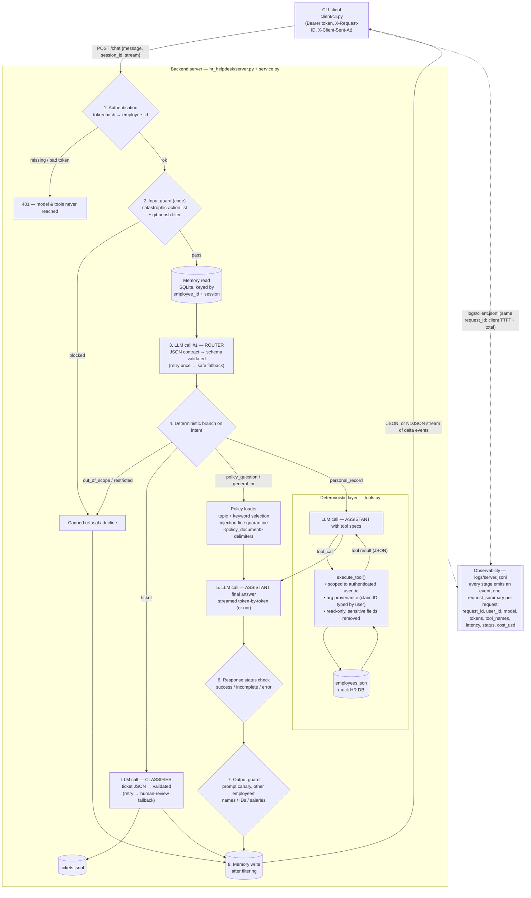

# Architecture — HR Helpdesk Assistant V1

## Request–response flow



## Where things sit

| Concern | Location | Notes |
|---|---|---|
| Client | `client/cli.py` | Sends token + request ID + send timestamp; renders stream; logs client-side latency |
| Authentication | `hr_helpdesk/auth.py` | SHA-256 token hashes, constant-time compare; 401 before any model/tool work |
| Catastrophic-action guard | `hr_helpdesk/guardrails.py` | Input check (before model) + output check (after model) |
| Router contract | `hr_helpdesk/schemas.py::ROUTER_SCHEMA` | `intent`, `policy_topics`, `record_type`, `refers_to_other_employee`, `reason` |
| Ticket contract | `hr_helpdesk/schemas.py::TICKET_SCHEMA` | `category`, `urgency`, `requires_human_review`, `needs_clarification`, `clarification_question`, `summary`, `urgency_reason` |
| Deterministic layer | `hr_helpdesk/tools.py` + `data/employees.json` | `get_leave_balance`, `get_reimbursement_status`; authorization in code |
| Policy context | `hr_helpdesk/policies.py` + `data/policies/*.md` | Full text of selected policies placed in context; no embeddings |
| Memory | `hr_helpdesk/memory.py` → `data/runtime/memory.db` | SQLite; filter before write |
| Streaming | `server.py` (chunked NDJSON) ← `llm.py::stream` (provider SSE) | `delta`, `ticket`, `replace`, `done` events |
| Observability & cost | `hr_helpdesk/observability.py` → `logs/server.jsonl` | Lifecycle events + `request_summary` with `cost_usd` |

## Structured response contract (model → backend)

The model never "decides" an action in free text. Every decision point returns JSON that is
validated before the backend acts:

```json
// Router (every turn)
{"intent": "personal_record", "policy_topics": [], "record_type": "leave_balance",
 "refers_to_other_employee": false, "reason": "Own leave balance lookup."}

// Ticket classifier
{"category": "payroll", "urgency": "high", "requires_human_review": true,
 "needs_clarification": false, "clarification_question": null,
 "summary": "September salary not credited.", "urgency_reason": "Salary not received; rent due on the 5th."}

// Tool calls use the provider's native function-calling format, and the arguments are
// re-validated in tools.py (JSON object, required keys, ownership, provenance).
```

Only the final conversational answer is free text, and it still passes the status check and
the output guard before the client sees it.
